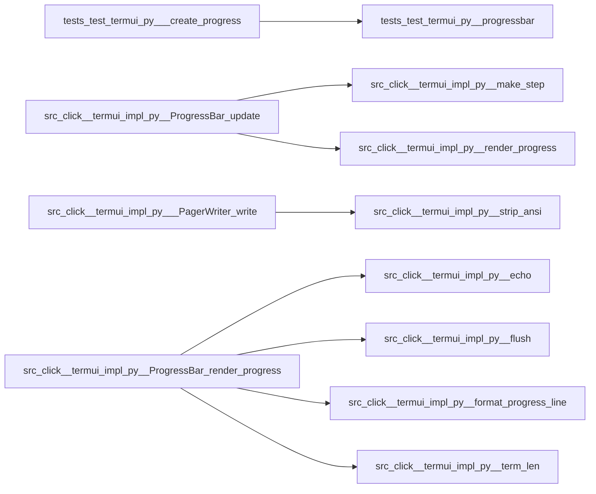

# click-req-3878

## 需求原文

## 背景

`CliRunner` 收到 `<stdin>` 里的控制字节时，原样传给命令，也原样
回显，终端上看不出用户按了什么。

| `<stdin>` 字节 | 回显到 `<stdout>` | 按键 |
|---|---|---|
| `\x04` | `^D\n` | Unix 的 Ctrl+D |
| `\x1a` | `^Z\n` | Windows 的 Ctrl+Z |

## 需求

改 `CliRunner`：把 `\x04` 和 `\x1a` 这两个控制字节翻译后回显为
`^D` 和 `^Z`，且不再把它们传给命令。

## 验收标准

- 输入 `\x04` 时回显 `^D\n`，输入 `\x1a` 时回显 `^Z\n`。
- 命令收不到这两个字节。
- 这是行为变更，目标版本 8.6.0。

## 来源

- pallets/click PR #3878《Print `\x04` and `\x1a` input bytes as
  `^D` and `^Z` in `CliRunner`》（2026-11-06 已合并；作者 kdeldycke）
- 本文档是盲测输入：只含需求描述，已隐去真实改动文件清单。

来源：examples/click-req-3878.md

## 相关文件 / 函数

| 文件 | 关联 | 命中符号 |
| --- | --- | --- |
| [src/click/testing.py](https://github.com/pallets/click/blob/08b803c/src/click/testing.py) | 种子 | `CliRunner` (L341), `Result.stdout` (L319) |
| [CHANGES.md](https://github.com/pallets/click/blob/08b803c/CHANGES.md) | 种子 | — |
| [docs/testing.md](https://github.com/pallets/click/blob/08b803c/docs/testing.md) | 种子 | — |
| [tests/test_termui.py](https://github.com/pallets/click/blob/08b803c/tests/test_termui.py) | 种子 | `test_echo_via_pager_streams_each_write.RecordingStream.write` (L937), `FakeClock.time` (L33), `_create_progress` (L37) |
| [src/click/_termui_impl.py](https://github.com/pallets/click/blob/08b803c/src/click/_termui_impl.py) | 种子 | `ProgressBar.update` (L318), `_PagerWriter.write` (L401), `ProgressBar.render_progress` (L250) |
| [tests/test_testing.py](https://github.com/pallets/click/blob/08b803c/tests/test_testing.py) | 1 跳邻居 | `test_echo_stdin_control_bytes` (L102), `test_with_echo_via_pager` (L304), `test_catch_exceptions_cli_runner` (L235), `test_capture_fd_stale_reference` (L783), `test_pdb_explicit_streams_honored` (L715) |
| [tests/test_stream_lifecycle.py](https://github.com/pallets/click/blob/08b803c/tests/test_stream_lifecycle.py) | 1 跳邻居 | `test_sequential_threaded_invokes` (L360), `test_exception_does_not_corrupt_next_invoke` (L430), `test_getvalue_after_isolation_exit` (L142), `test_invoke_with_logger_and_prompt` (L208), `test_sys_streams_restored_after_exception` (L475) |
| [tests/test_options.py](https://github.com/pallets/click/blob/08b803c/tests/test_options.py) | 1 跳邻居 | `test_flag_value_on_option_with_zero_or_one_args` (L3899) |
| [src/click/termui.py](https://github.com/pallets/click/blob/08b803c/src/click/termui.py) | 2 跳邻居 | `prompt` (L139), `style` (L641), `_interpret_color` (L616) |
| [tests/conftest.py](https://github.com/pallets/click/blob/08b803c/tests/conftest.py) | 1 跳邻居 | `runner` (L7) |

共 10 个文件，约 6842 tokens（预算内）。

## 调用链

## 群消息佐证

暂无。

## 验收

- [ ] 核心改动文件在上方清单中
- [ ] 召回覆盖真实改动文件（盲测见 `tests/test_blind.py`）

