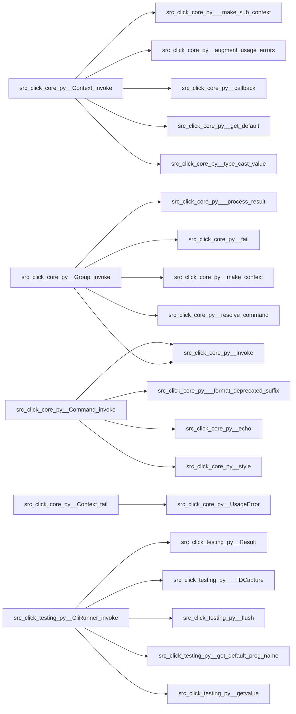

# click-req-3896

## 需求原文

## 背景

`CliRunner.invoke()` 会把多余的关键字参数传给命令的 `Context`，
但 `color` 例外：`invoke()` 自己有一个 `color` 参数占了这个名字。
于是测试里没法在同一次调用中，既设定终端支持情况、又设定
`Context` 的 `color`。

这个问题 5 年前在 #2110 提过，当时被认为太小众；此后 Click 做了一
系列颜色处理改进（#3505、#3653、#3739），颜色相关的测试多了很多，
不再是小众需求。

## 需求

给 `CliRunner.invoke()` 加一个 `context_settings` 参数，让测试能把
上下文相关的设置传给命令的 `Context`，从而解决 `color` 的名字冲突。

## 验收标准

- `CliRunner.invoke()` 接受 `context_settings` 参数，并把它传给 `Context`。
- 一次调用里能同时设定终端支持情况和 `Context` 的 `color`。
- 已有 `color` 参数的行为不变。

## 来源

- pallets/click PR #3896《Add `context_settings` parameter to `CliRunner.invoke`》
  （2026-11-06 已合并；作者 kdeldycke）
- 本文档是盲测输入：只含需求描述，已隐去真实改动文件清单；
  需求正文提到的两个测试函数名已略去（那是验收证据，不是需求本身）。

来源：examples/click-req-3896.md

## 相关文件 / 函数

| 文件 | 关联 | 命中符号 |
| --- | --- | --- |
| [src/click/core.py](https://github.com/pallets/click/blob/08b803c/src/click/core.py) | 种子 | `Context.invoke` (L877), `Group.invoke` (L2043), `Command.invoke` (L1423), `Context.fail` (L834) |
| [src/click/testing.py](https://github.com/pallets/click/blob/08b803c/src/click/testing.py) | 种子 | `CliRunner.invoke` (L625), `BytesIOCopy.write` (L157), `BytesIOCopy.flush` (L153), `_FDCapture.start` (L124) |
| [tests/test_testing.py](https://github.com/pallets/click/blob/08b803c/tests/test_testing.py) | 种子 | `test_args` (L439), `test_catch_exceptions` (L211), `test_env` (L384), `test_capture_fd_windows_error` (L759), `test_pdb_init_restored_after_invoke` (L732) |
| [tests/test_options.py](https://github.com/pallets/click/blob/08b803c/tests/test_options.py) | 种子 | `test_dual_options_custom_type_sentinel_flag_value.main` (L2447), `test_default_dual_option_callback.main` (L2015), `test_custom_type_flag_value_dual_options` (L2687), `test_default_dual_option_callback` (L1997), `test_show_default_boolean_flag_name` (L1611) |
| [docs/testing.md](https://github.com/pallets/click/blob/08b803c/docs/testing.md) | 种子 | — |
| [tests/test_termui.py](https://github.com/pallets/click/blob/08b803c/tests/test_termui.py) | 1 跳邻居 | `test_choices_list_in_prompt` (L257), `test_progressbar_update` (L318), `test_prompt_required_with_required` (L1339), `test_progressbar_hidden_manual` (L101), `test_progressbar_strip_regression` (L44) |
| [tests/test_defaults.py](https://github.com/pallets/click/blob/08b803c/tests/test_defaults.py) | 1 跳邻居 | `test_lookup_default_callable_in_default_map` (L202), `test_default_map_source` (L253), `test_flag_default_map` (L110), `test_nargs_plus_multiple` (L63), `test_basic_defaults` (L22) |
| [tests/test_basic.py](https://github.com/pallets/click/blob/08b803c/tests/test_basic.py) | 1 跳邻居 | `test_option_reusing_help_flag` (L88), `test_basic_functionality` (L12), `test_choice_argument_custom_type` (L584), `test_param_squatting_help_option_name` (L71), `test_boolean_switch` (L303) |
| [tests/test_commands.py](https://github.com/pallets/click/blob/08b803c/tests/test_commands.py) | 种子 | `test_custom_parser.OptParseCommand.invoke` (L171), `test_other_command_invoke.cli` (L11), `test_custom_parser` (L144), `test_deprecated_in_help_messages` (L554), `test_group_with_args` (L129) |
| [tests/test_custom_classes.py](https://github.com/pallets/click/blob/08b803c/tests/test_custom_classes.py) | 1 跳邻居 | `test_context_invoke_type` (L20), `test_context_invoke_type.first` (L40) |

共 10 个文件，约 7350 tokens（预算内）。

## 调用链

## 群消息佐证

- 2026-11-05 10:21 王鹏（任务网探索研究群）：CliRunner.invoke 那个 color 冲突有人遇到过吗？测试里想同时定终端支持和 Context 的 color，一次调用传不进去。
- 2026-11-05 10:24 张峰（任务网探索研究群）：遇到过，invoke 自己占了 color 这个名字。加个 context_settings 参数透传给 Context 就能解。
- 2026-11-05 10:31 王鹏（任务网探索研究群）：那就这么定：context_settings 专门走 Context 的设置，color 保持现状不动。

## 验收

- [ ] 核心改动文件在上方清单中
- [ ] 召回覆盖真实改动文件（盲测见 `tests/test_blind.py`）

