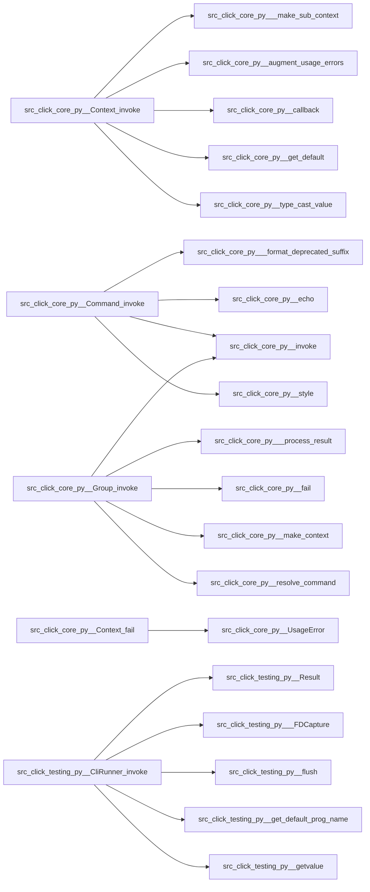

# click-req-3896

## 需求原文

## 背景

`CliRunner.invoke()` 会把多余的关键字参数传给命令的 `Context`，
但 `color` 例外：`invoke()` 自己有一个 `color` 参数占了这个名字。
于是测试里没法在同一次调用中，既设定终端支持情况、又设定
`Context` 的 `color`。

这个问题 5 年前在 #2110 提过，当时被认为太小众；此后 Click 做了一
系列颜色处理改进（#3505、#3653、#3739），颜色相关的测试多了很多，
不再是小众需求。

## 需求

给 `CliRunner.invoke()` 加一个 `context_settings` 参数，让测试能把
上下文相关的设置传给命令的 `Context`，从而解决 `color` 的名字冲突。

## 验收标准

- `CliRunner.invoke()` 接受 `context_settings` 参数，并把它传给 `Context`。
- 一次调用里能同时设定终端支持情况和 `Context` 的 `color`。
- 已有 `color` 参数的行为不变。

## 来源

- pallets/click PR #3896《Add `context_settings` parameter to `CliRunner.invoke`》
  （2026-11-06 已合并；作者 kdeldycke）
- 本文档是盲测输入：只含需求描述，已隐去真实改动文件清单；
  需求正文提到的两个测试函数名已略去（那是验收证据，不是需求本身）。

来源：examples/click-req-3896.md

## 相关文件 / 函数

| 文件 | 关联 | 命中符号 |
| --- | --- | --- |
| [src/click/core.py](https://github.com/pallets/click/blob/08b803c/src/click/core.py) | 种子 | `Context.invoke` (L877), `Command.invoke` (L1423), `Group.invoke` (L2043), `Context.fail` (L834) |
| [src/click/testing.py](https://github.com/pallets/click/blob/08b803c/src/click/testing.py) | 种子 | `CliRunner.invoke` (L625), `BytesIOCopy.write` (L157), `BytesIOCopy.flush` (L153), `_FDCapture.start` (L124) |
| [tests/test_commands.py](https://github.com/pallets/click/blob/08b803c/tests/test_commands.py) | 种子 | `test_custom_parser.OptParseCommand.invoke` (L171), `test_abort_exceptions_with_disabled_standalone_mode` (L675), `test_aliased_command_canonical_name` (L329), `test_auto_shorthelp` (L66), `test_command_no_args_is_help` (L98) |
| [tests/test_testing.py](https://github.com/pallets/click/blob/08b803c/tests/test_testing.py) | 种子 | `test_args` (L439), `test_capture_fd_faulthandler` (L855), `test_capture_fd_logging_handler` (L809), `test_capture_fd_nesting` (L913), `test_capture_fd_nesting.outer_cli` (L921) |
| [tests/test_options.py](https://github.com/pallets/click/blob/08b803c/tests/test_options.py) | 种子 | `test_default_dual_option_callback.main` (L2015), `test_dual_options_custom_type_sentinel_flag_value.main` (L2447), `test_aliases_for_flags` (L1418), `test_argument_custom_class` (L1273), `test_argument_sharing_param_name_warning` (L3704) |
| [docs/testing.md](https://github.com/pallets/click/blob/08b803c/docs/testing.md) | 种子 | — |
| [tests/test_termui.py](https://github.com/pallets/click/blob/08b803c/tests/test_termui.py) | 1 跳邻居 | `test_choices_list_in_prompt` (L257), `test_confirmation_prompt` (L1390), `test_echo_via_pager_tty_pager_missing` (L1038), `test_false_show_default_cause_no_default_display_in_prompt` (L1447), `test_file_prompt_default_format` (L285) |
| [tests/test_defaults.py](https://github.com/pallets/click/blob/08b803c/tests/test_defaults.py) | 1 跳邻居 | `test_basic_defaults` (L22), `test_default_map_nargs` (L519), `test_default_map_source` (L253), `test_default_map_with_callable_flag_value` (L481), `test_flag_default_map` (L110) |
| [tests/test_basic.py](https://github.com/pallets/click/blob/08b803c/tests/test_basic.py) | 1 跳邻居 | `test_basic_functionality` (L12), `test_basic_group` (L137), `test_boolean_conversion` (L342), `test_boolean_flag` (L325), `test_boolean_switch` (L303) |
| [tests/test_custom_classes.py](https://github.com/pallets/click/blob/08b803c/tests/test_custom_classes.py) | 1 跳邻居 | `test_context_invoke_type` (L20), `test_context_invoke_type.first` (L40) |

共 10 个文件，约 7216 tokens（预算内），分级：full——完整（跨多文件、核心逻辑）。

## 调用链

## 影响面

改种子文件之前先看这一节：列出调用种子符号的上游文件，也就是改动最先波及的地方（取每文件前 3 个调用者，按调用者重要性排序）。

- 改 `src/click/core.py` 会波及：`src/click/core.py` 的 `Command.invoke`、`src/click/core.py` 的 `Group.invoke`、`src/click/core.py` 的 `Group.invoke._process_result`
- 改 `src/click/testing.py` 会波及：`src/click/decorators.py` 的 `make_pass_decorator.decorator.new_func`、`src/click/decorators.py` 的 `pass_meta_key.decorator.new_func`、`tests/conftest.py` 的 `runner`
- 改 `tests/test_commands.py` 会波及：`src/click/decorators.py` 的 `make_pass_decorator.decorator.new_func`、`src/click/decorators.py` 的 `pass_meta_key.decorator.new_func`、`tests/test_arguments.py` 的 `test_argument_custom_class_can_override_type_cast_value_and_never_sees_unset`

## 群消息佐证

- 2026-11-05 10:21 王鹏（任务网探索研究群）：CliRunner.invoke 那个 color 冲突有人遇到过吗？测试里想同时定终端支持和 Context 的 color，一次调用传不进去。
- 2026-11-05 10:24 张峰（任务网探索研究群）：遇到过，invoke 自己占了 color 这个名字。加个 context_settings 参数透传给 Context 就能解。
- 2026-11-05 10:31 王鹏（任务网探索研究群）：那就这么定：context_settings 专门走 Context 的设置，color 保持现状不动。

## 验收

- [ ] 核心改动文件在上方清单中
- [ ] 召回覆盖真实改动文件（盲测见 `tests/test_blind.py`）

