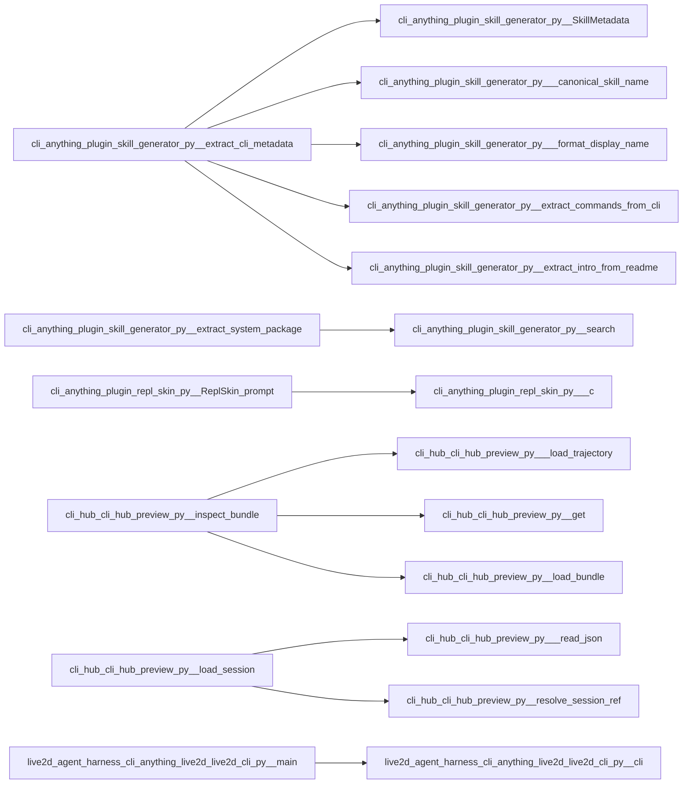

# req-core

## 需求原文

## 背景

CLI-Anything 的核心不是“写了很多 CLI”，而是“能批量生出 CLI 的机制”：
一个 7 阶段全自动流水线（从代码库分析到 PyPI 发布），外加运行时
的一套统一打法。本需求要这套机制的关键点。

## 需求

- 说清 7 阶段流水线：插件怎么接手一个代码库，经过架构设计、实现、
  测试规划、测试编写、文档，最后发到 PyPI（`cli-anything-plugin`
  的 `commands/`：`cli-anything.md`、`refine.md`、`test.md`、
  `validate.md`，方法论以 `HARNESS.md` 为准）。
- 说清运行时统一打法：双模式（裸命令进 REPL 交互、子命令走脚本管道）、
  有状态会话与 undo/redo、`repl_skin.py` 统一 REPL 界面（`ReplSkin`）、
  每个命令的 `--json` 结构化输出、所有 CLI 共用 `cli_anything.*`
  命名空间。
- 说清 `SKILL.md` 是怎么来的：流水线 6.5 阶段的 `skill_generator.py`
  从 Click 装饰器、`setup.py`、README 抽元数据生成，canonical 文件在
  `skills/cli-anything-<软件>/SKILL.md`，包内另有一份兼容副本。
- 说清预览机制：`docs/PREVIEW_PROTOCOL.md` 里 `preview` 的生产与消费
  分工（`cli-anything-<软件> preview` 写状态，`cli-hub previews` 看状态）。

## 验收标准

- [ ] 知识页说清 7 阶段流水线的各阶段与入口命令
- [ ] 知识页说清 REPL/子命令双模式、有状态会话、`--json` 输出
- [ ] 知识页说清 `skill_generator.py` 的输入与两份 SKILL.md 的关系
- [ ] 知识页说清预览机制的生产消费分工
- [ ] 最小上下文 ≤10 个文件，≤8000 tokens

来源：/home/hatch/workspace/req-code-kb-work/cli-anything-kb/req-core.md

## 相关文件 / 函数

| 文件 | 关联 | 命中符号 |
| --- | --- | --- |
| [cli-anything-plugin/HARNESS.md](https://github.com/HKUDS/CLI-Anything/blob/34f519533bc175d2fe287ab8316b0dd99bb9cc43/cli-anything-plugin/HARNESS.md) | 种子 | — |
| [docs/PREVIEW_PROTOCOL.md](https://github.com/HKUDS/CLI-Anything/blob/34f519533bc175d2fe287ab8316b0dd99bb9cc43/docs/PREVIEW_PROTOCOL.md) | 种子 | — |
| [cli-anything-plugin/commands/validate.md](https://github.com/HKUDS/CLI-Anything/blob/34f519533bc175d2fe287ab8316b0dd99bb9cc43/cli-anything-plugin/commands/validate.md) | 种子 | — |
| [cli-anything-plugin/commands/refine.md](https://github.com/HKUDS/CLI-Anything/blob/34f519533bc175d2fe287ab8316b0dd99bb9cc43/cli-anything-plugin/commands/refine.md) | 种子 | — |
| [cli-anything-plugin/skill_generator.py](https://github.com/HKUDS/CLI-Anything/blob/34f519533bc175d2fe287ab8316b0dd99bb9cc43/cli-anything-plugin/skill_generator.py) | 种子 | `extract_cli_metadata` (L116), `_format_display_name` (L21), `extract_system_package` (L216) |
| [cli-anything-plugin/repl_skin.py](https://github.com/HKUDS/CLI-Anything/blob/34f519533bc175d2fe287ab8316b0dd99bb9cc43/cli-anything-plugin/repl_skin.py) | 种子 | `ReplSkin` (L106), `ReplSkin.prompt` (L247) |
| [cli-hub/cli_hub/preview.py](https://github.com/HKUDS/CLI-Anything/blob/34f519533bc175d2fe287ab8316b0dd99bb9cc43/cli-hub/cli_hub/preview.py) | 种子 | `_NoCacheHandler.end_headers` (L1790), `inspect_bundle` (L513), `load_session` (L65) |
| [eth2-quickstart/agent-harness/cli_anything/eth2_quickstart/core/commands.py](https://github.com/HKUDS/CLI-Anything/blob/34f519533bc175d2fe287ab8316b0dd99bb9cc43/eth2-quickstart/agent-harness/cli_anything/eth2_quickstart/core/commands.py) | 种子 | `validator_plan` (L27) |
| [live2d/agent-harness/cli_anything/live2d/live2d_cli.py](https://github.com/HKUDS/CLI-Anything/blob/34f519533bc175d2fe287ab8316b0dd99bb9cc43/live2d/agent-harness/cli_anything/live2d/live2d_cli.py) | 种子 | `main` (L125) |

共 9 个文件，约 8000 tokens（预算内），分级：full——完整（跨多文件、核心逻辑）。

## 调用链

## 影响面

改种子文件之前先看这一节：列出调用种子符号的上游文件，也就是改动最先波及的地方（取每文件前 3 个调用者，按调用者重要性排序）。

- 改 `cli-anything-plugin/repl_skin.py` 会波及：`nslogger/agent-harness/cli_anything/nslogger/nslogger_cli.py` 的 `_run_repl`、`cloudanalyzer/agent-harness/cli_anything/cloudanalyzer/cloudanalyzer_cli.py` 的 `_start_repl`、`mailchimp/agent-harness/cli_anything/mailchimp/mailchimp_cli.py` 的 `_start_repl`
- 改 `live2d/agent-harness/cli_anything/live2d/live2d_cli.py` 会波及：`macrocli/agent-harness/cli_anything/macrocli/core/runtime.py` 的 `MacroRuntime.validate_macro`、`live2d/agent-harness/cli_anything/live2d/live2d_cli.py` 的 `main`、`macrocli/agent-harness/cli_anything/macrocli/tests/test_core.py` 的 `TestMacroModel.test_structural_validation_bad_backend`

## 群消息佐证

暂无。

## 验收

- [ ] 核心改动文件在上方清单中
- [ ] 召回覆盖真实改动文件（盲测见 `tests/test_blind.py`）

