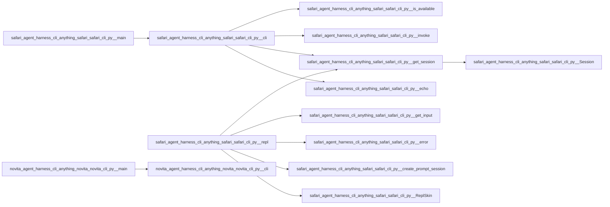

# req-core

## 需求原文

## 背景

CLI-Anything 的核心不是“写了很多 CLI”，而是“能批量生出 CLI 的机制”：
一个 7 阶段全自动流水线（从代码库分析到 PyPI 发布），外加运行时
的一套统一打法。本需求要这套机制的关键点。

## 需求

- 说清 7 阶段流水线：插件怎么接手一个代码库，经过架构设计、实现、
  测试规划、测试编写、文档，最后发到 PyPI（`cli-anything-plugin`
  的 `commands/`：`cli-anything.md`、`refine.md`、`test.md`、
  `validate.md`，方法论以 `HARNESS.md` 为准）。
- 说清运行时统一打法：双模式（裸命令进 REPL 交互、子命令走脚本管道）、
  有状态会话与 undo/redo、`repl_skin.py` 统一 REPL 界面（`ReplSkin`）、
  每个命令的 `--json` 结构化输出、所有 CLI 共用 `cli_anything.*`
  命名空间。
- 说清 `SKILL.md` 是怎么来的：流水线 6.5 阶段的 `skill_generator.py`
  从 Click 装饰器、`setup.py`、README 抽元数据生成，canonical 文件在
  `skills/cli-anything-<软件>/SKILL.md`，包内另有一份兼容副本。
- 说清预览机制：`docs/PREVIEW_PROTOCOL.md` 里 `preview` 的生产与消费
  分工（`cli-anything-<软件> preview` 写状态，`cli-hub previews` 看状态）。

## 验收标准

- [ ] 知识页说清 7 阶段流水线的各阶段与入口命令
- [ ] 知识页说清 REPL/子命令双模式、有状态会话、`--json` 输出
- [ ] 知识页说清 `skill_generator.py` 的输入与两份 SKILL.md 的关系
- [ ] 知识页说清预览机制的生产消费分工
- [ ] 最小上下文 ≤10 个文件，≤8000 tokens

来源：/home/hatch/workspace/req-code-kb-work/cli-anything-kb/req-core.md

## 相关文件 / 函数

| 文件 | 关联 | 命中符号 |
| --- | --- | --- |
| [README_CN.md](https://github.com/HKUDS/CLI-Anything/blob/34f519533bc175d2fe287ab8316b0dd99bb9cc43/README_CN.md) | 种子 | — |
| [codex-skill/SKILL.md](https://github.com/HKUDS/CLI-Anything/blob/34f519533bc175d2fe287ab8316b0dd99bb9cc43/codex-skill/SKILL.md) | 种子 | — |
| [cli-anything-plugin/HARNESS.md](https://github.com/HKUDS/CLI-Anything/blob/34f519533bc175d2fe287ab8316b0dd99bb9cc43/cli-anything-plugin/HARNESS.md) | 种子 | — |
| [cli-hub/cli_hub/matrix_skill.py](https://github.com/HKUDS/CLI-Anything/blob/34f519533bc175d2fe287ab8316b0dd99bb9cc43/cli-hub/cli_hub/matrix_skill.py) | 2 跳邻居 | `_render_stage_tooling` (L355), `render_matrix_skill_file` (L116), `_render_discovery_section` (L395) |
| [safari/agent-harness/cli_anything/safari/safari_cli.py](https://github.com/HKUDS/CLI-Anything/blob/34f519533bc175d2fe287ab8316b0dd99bb9cc43/safari/agent-harness/cli_anything/safari/safari_cli.py) | 种子 | `cli` (L189), `get_session` (L81), `main` (L621), `repl` (L553) |
| [sbox/agent-harness/cli_anything/sbox/tests/test_exit_codes.py](https://github.com/HKUDS/CLI-Anything/blob/34f519533bc175d2fe287ab8316b0dd99bb9cc43/sbox/agent-harness/cli_anything/sbox/tests/test_exit_codes.py) | 2 跳邻居 | `_run` (L27), `TestOneShotFailureExitsNonZero` (L51), `TestOneShotFailureExitsNonZero.test_help_exits_zero` (L54) |
| [safari/agent-harness/cli_anything/safari/tests/test_parity.py](https://github.com/HKUDS/CLI-Anything/blob/34f519533bc175d2fe287ab8316b0dd99bb9cc43/safari/agent-harness/cli_anything/safari/tests/test_parity.py) | 2 跳邻居 | `_cli_name_for` (L27), `TestParityToolCoverage` (L35), `TestParityToolCoverage.setup_method` (L38) |
| [mubu/agent-harness/skill_generator.py](https://github.com/HKUDS/CLI-Anything/blob/34f519533bc175d2fe287ab8316b0dd99bb9cc43/mubu/agent-harness/skill_generator.py) | 2 跳邻居 | `extract_cli_metadata` (L213) |
| [docs/scripts/freecad_live_preview_demo.py](https://github.com/HKUDS/CLI-Anything/blob/34f519533bc175d2fe287ab8316b0dd99bb9cc43/docs/scripts/freecad_live_preview_demo.py) | 2 跳邻居 | `_hex_rgb` (L4082), `_rgba` (L4087) |
| [novita/agent-harness/cli_anything/novita/novita_cli.py](https://github.com/HKUDS/CLI-Anything/blob/34f519533bc175d2fe287ab8316b0dd99bb9cc43/novita/agent-harness/cli_anything/novita/novita_cli.py) | 种子 | `main` (L422) |

共 10 个文件，约 7990 tokens（预算内）。

## 调用链

## 群消息佐证

暂无。

## 验收

- [ ] 核心改动文件在上方清单中
- [ ] 召回覆盖真实改动文件（盲测见 `tests/test_blind.py`）

