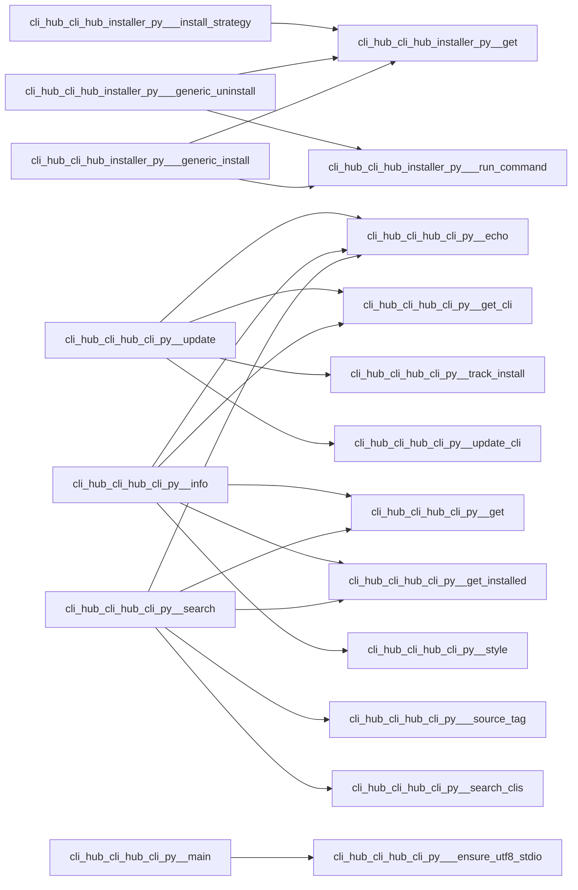

# req-hub

## 需求原文

## 背景

CLI-Hub（`cli-hub`，包名 `cli-anything-hub`）是 CLI-Anything 的包管理器：
用户在终端里用 `cli-hub list` 浏览、`cli-hub search` 搜索、`cli-hub info`
看详情、`cli-hub install` / `cli-hub update` / `cli-hub uninstall` 装卸
40 多个软件的 CLI 外壳（GIMP、Blender、Inkscape、LibreOffice 等）。

要搞懂三件事：①发现——注册表从哪来、怎么缓存；②安装——装一个 CLI
时按什么策略装、装完的状态记在哪；③入口——六个子命令是怎么分派的。

## 需求

- 说清 `cli-hub list` / `search` / `info` / `install` / `update` /
  `uninstall` 六个命令的入口与分派（`cli.py` 里的 `main`、`list_clis`、
  `search`、`info`、`install`、`uninstall`、`update`）。
- 说清注册表机制：`fetch_registry`、`fetch_public_registry`、
  `fetch_all_clis`、`get_cli`、`search_clis`、`list_categories` 各自取
  哪份数据（`registry.json` / `public_registry.json`），`_fetch_json`
  的缓存是怎么做的。
- 说清安装机制：`_install_strategy` 怎么选策略，`_generic_install` /
  `_generic_uninstall` 做了什么，已安装状态怎么持久化
  （`_load_installed` / `_save_installed`）。
- 预览（`previews`）与 matrix（`matrix`）子命令不在本次范围，只在
  相关文件被引用时顺带提一句。

## 验收标准

- [ ] 知识页包含六个命令的入口与分派链
- [ ] 知识页说清两份注册表的来源与缓存机制
- [ ] 知识页说清安装策略选择与已安装状态的持久化
- [ ] 最小上下文 ≤10 个文件，≤8000 tokens

来源：/home/hatch/workspace/req-code-kb-work/cli-anything-kb/req-hub.md

## 相关文件 / 函数

| 文件 | 关联 | 命中符号 |
| --- | --- | --- |
| [cli-hub/cli_hub/installer.py](https://github.com/HKUDS/CLI-Anything/blob/34f519533bc175d2fe287ab8316b0dd99bb9cc43/cli-hub/cli_hub/installer.py) | 种子 | `_load_installed` (L19), `_install_strategy` (L106), `_save_installed` (L28), `_generic_uninstall` (L132), `_generic_install` (L122) |
| [cli-hub/cli_hub/cli.py](https://github.com/HKUDS/CLI-Anything/blob/34f519533bc175d2fe287ab8316b0dd99bb9cc43/cli-hub/cli_hub/cli.py) | 种子 | `update` (L163), `info` (L260), `search` (L235), `main` (L102), `uninstall` (L150) |
| [cli-hub/cli_hub/registry.py](https://github.com/HKUDS/CLI-Anything/blob/34f519533bc175d2fe287ab8316b0dd99bb9cc43/cli-hub/cli_hub/registry.py) | 种子 | `get_cli` (L93), `fetch_all_clis` (L73), `_fetch_json` (L32), `fetch_registry` (L60), `fetch_public_registry` (L65) |
| [README.md](https://github.com/HKUDS/CLI-Anything/blob/34f519533bc175d2fe287ab8316b0dd99bb9cc43/README.md) | 种子 | — |
| [.github/scripts/generate_meta_skill.py](https://github.com/HKUDS/CLI-Anything/blob/34f519533bc175d2fe287ab8316b0dd99bb9cc43/.github/scripts/generate_meta_skill.py) | 种子 | `main` (L7) |
| [cli-hub/cli_hub/matrix_skill.py](https://github.com/HKUDS/CLI-Anything/blob/34f519533bc175d2fe287ab8316b0dd99bb9cc43/cli-hub/cli_hub/matrix_skill.py) | 1 跳邻居 | `_render_injected_section` (L231), `_find_repo_root` (L45) |
| [cli-hub/cli_hub/matrix.py](https://github.com/HKUDS/CLI-Anything/blob/34f519533bc175d2fe287ab8316b0dd99bb9cc43/cli-hub/cli_hub/matrix.py) | 1 跳邻居 | `resolve_install_scope` (L352), `fetch_matrix_registry` (L65) |
| [cli-hub/tests/test_cli_hub.py](https://github.com/HKUDS/CLI-Anything/blob/34f519533bc175d2fe287ab8316b0dd99bb9cc43/cli-hub/tests/test_cli_hub.py) | 1 跳邻居 | `_make_preview_session` (L293), `TestUvStrategy.test_strategy_uv_not_overridden_by_install_strategy_field` (L1042), `TestRegistry.test_list_categories` (L461), `TestRegistry.test_fetch_registry_uses_cache_on_refresh_failure` (L395), `TestUvStrategy.test_strategy_detected_as_uv` (L1039) |
| [safari/agent-harness/cli_anything/safari/safari_cli.py](https://github.com/HKUDS/CLI-Anything/blob/34f519533bc175d2fe287ab8316b0dd99bb9cc43/safari/agent-harness/cli_anything/safari/safari_cli.py) | 种子 | `cli` (L189), `main` (L621), `_build_tool_command.run` (L249), `get_session` (L81) |
| [lldb/agent-harness/cli_anything/lldb/dap.py](https://github.com/HKUDS/CLI-Anything/blob/34f519533bc175d2fe287ab8316b0dd99bb9cc43/lldb/agent-harness/cli_anything/lldb/dap.py) | 种子 | `main` (L991), `LLDBDebugAdapter.run` (L223), `StopRule.matches` (L118), `LLDBDebugAdapter._configure_stop_rules` (L667) |

共 10 个文件，约 7900 tokens（预算内）。

## 调用链

## 群消息佐证

暂无。

## 验收

- [ ] 核心改动文件在上方清单中
- [ ] 召回覆盖真实改动文件（盲测见 `tests/test_blind.py`）

