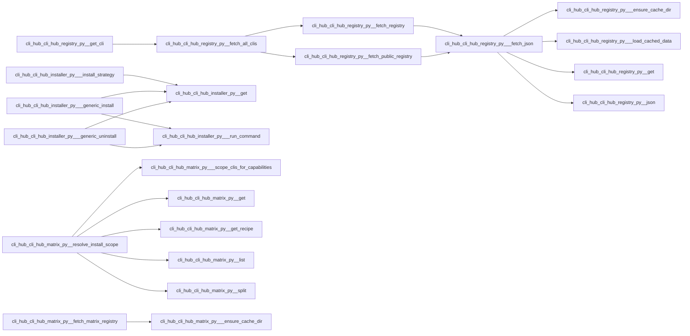

# req-hub

## 需求原文

## 背景

CLI-Hub（`cli-hub`，包名 `cli-anything-hub`）是 CLI-Anything 的包管理器：
用户在终端里用 `cli-hub list` 浏览、`cli-hub search` 搜索、`cli-hub info`
看详情、`cli-hub install` / `cli-hub update` / `cli-hub uninstall` 装卸
40 多个软件的 CLI 外壳（GIMP、Blender、Inkscape、LibreOffice 等）。

要搞懂三件事：①发现——注册表从哪来、怎么缓存；②安装——装一个 CLI
时按什么策略装、装完的状态记在哪；③入口——六个子命令是怎么分派的。

## 需求

- 说清 `cli-hub list` / `search` / `info` / `install` / `update` /
  `uninstall` 六个命令的入口与分派（`cli.py` 里的 `main`、`list_clis`、
  `search`、`info`、`install`、`uninstall`、`update`）。
- 说清注册表机制：`fetch_registry`、`fetch_public_registry`、
  `fetch_all_clis`、`get_cli`、`search_clis`、`list_categories` 各自取
  哪份数据（`registry.json` / `public_registry.json`），`_fetch_json`
  的缓存是怎么做的。
- 说清安装机制：`_install_strategy` 怎么选策略，`_generic_install` /
  `_generic_uninstall` 做了什么，已安装状态怎么持久化
  （`_load_installed` / `_save_installed`）。
- 预览（`previews`）与 matrix（`matrix`）子命令不在本次范围，只在
  相关文件被引用时顺带提一句。

## 验收标准

- [ ] 知识页包含六个命令的入口与分派链
- [ ] 知识页说清两份注册表的来源与缓存机制
- [ ] 知识页说清安装策略选择与已安装状态的持久化
- [ ] 最小上下文 ≤10 个文件，≤8000 tokens

来源：本页「需求原文」

## 相关文件 / 函数

| 文件 | 关联 | 命中符号 |
| --- | --- | --- |
| [cli-hub/cli_hub/registry.py](https://github.com/HKUDS/CLI-Anything/blob/34f519533bc175d2fe287ab8316b0dd99bb9cc43/cli-hub/cli_hub/registry.py) | 种子 | `get_cli` (L93), `fetch_all_clis` (L73), `_fetch_json` (L32), `fetch_registry` (L60), `fetch_public_registry` (L65) |
| [cli-hub/cli_hub/installer.py](https://github.com/HKUDS/CLI-Anything/blob/34f519533bc175d2fe287ab8316b0dd99bb9cc43/cli-hub/cli_hub/installer.py) | 种子 | `_load_installed` (L19), `_install_strategy` (L106), `_save_installed` (L28), `_generic_install` (L122), `_generic_uninstall` (L132) |
| [cli-hub/cli_hub/matrix.py](https://github.com/HKUDS/CLI-Anything/blob/34f519533bc175d2fe287ab8316b0dd99bb9cc43/cli-hub/cli_hub/matrix.py) | 种子 | `resolve_install_scope` (L352), `fetch_matrix_registry` (L65) |
| [cli-hub/cli_hub/cli.py](https://github.com/HKUDS/CLI-Anything/blob/34f519533bc175d2fe287ab8316b0dd99bb9cc43/cli-hub/cli_hub/cli.py) | 种子 | `update` (L163), `info` (L260), `search` (L235), `main` (L102), `install` (L130) |
| [firefly-iii/agent-harness/cli_anything/firefly_iii/core/search.py](https://github.com/HKUDS/CLI-Anything/blob/34f519533bc175d2fe287ab8316b0dd99bb9cc43/firefly-iii/agent-harness/cli_anything/firefly_iii/core/search.py) | 种子 | `search` (L10), `search_transactions` (L19) |
| [README.md](https://github.com/HKUDS/CLI-Anything/blob/34f519533bc175d2fe287ab8316b0dd99bb9cc43/README.md) | 种子 | — |
| [cli-hub/cli_hub/matrix_skill.py](https://github.com/HKUDS/CLI-Anything/blob/34f519533bc175d2fe287ab8316b0dd99bb9cc43/cli-hub/cli_hub/matrix_skill.py) | 种子 | `_render_injected_section` (L231), `_find_repo_root` (L45) |
| [cli-hub/tests/test_cli_hub.py](https://github.com/HKUDS/CLI-Anything/blob/34f519533bc175d2fe287ab8316b0dd99bb9cc43/cli-hub/tests/test_cli_hub.py) | 1 跳邻居 | `_make_preview_session` (L293), `TestInstaller.test_load_installed_empty` (L909), `TestInstaller.test_save_and_load_installed` (L913), `TestRegistry.test_fetch_all_clis_does_not_mutate_registry_entries` (L408), `TestRegistry.test_fetch_registry_from_remote` (L384) |
| [safari/agent-harness/cli_anything/safari/safari_cli.py](https://github.com/HKUDS/CLI-Anything/blob/34f519533bc175d2fe287ab8316b0dd99bb9cc43/safari/agent-harness/cli_anything/safari/safari_cli.py) | 1 跳邻居 | `cli` (L189), `main` (L621), `_build_tool_command.run` (L249), `get_session` (L81) |
| [obsidian/agent-harness/cli_anything/obsidian/obsidian_cli.py](https://github.com/HKUDS/CLI-Anything/blob/34f519533bc175d2fe287ab8316b0dd99bb9cc43/obsidian/agent-harness/cli_anything/obsidian/obsidian_cli.py) | 种子 | `search` (L232), `cli` (L118), `main` (L461), `_require_api_key` (L104), `repl` (L404) |

共 10 个文件，约 7466 tokens（预算内），分级：full——完整（跨多文件、核心逻辑）。

## 调用链

## 影响面

改种子文件之前先看这一节：列出调用种子符号的上游文件，也就是改动最先波及的地方（取每文件前 3 个调用者，按调用者重要性排序）。

- 改 `cli-hub/cli_hub/registry.py` 会波及：`cli-hub/cli_hub/cli.py` 的 `update`、`cli-hub/cli_hub/registry.py` 的 `get_cli`、`cli-hub/cli_hub/registry.py` 的 `fetch_all_clis`
- 改 `cli-hub/cli_hub/installer.py` 会波及：`cli-hub/cli_hub/installer.py` 的 `update_cli`、`cli-hub/cli_hub/installer.py` 的 `install_cli`、`cli-hub/cli_hub/installer.py` 的 `_perform_action`
- 改 `cli-hub/cli_hub/cli.py` 会波及：`sbox/agent-harness/cli_anything/sbox/sbox_cli.py` 的 `repl.echo`、`libreoffice/agent-harness/cli_anything/libreoffice/core/document.py` 的 `create_document`、`sbox/agent-harness/cli_anything/sbox/core/session.py` 的 `Session.load`
- 改 `firefly-iii/agent-harness/cli_anything/firefly_iii/core/search.py` 会波及：`browser/agent-harness/cli_anything/browser/utils/domshell_backend.py` 的 `_parse_execute_result`、`nslogger/agent-harness/cli_anything/nslogger/core/filter.py` 的 `filter_messages`、`browser/agent-harness/cli_anything/browser/utils/domshell_backend.py` 的 `_extract_lane_id`
- 改 `obsidian/agent-harness/cli_anything/obsidian/obsidian_cli.py` 会波及：`mubu/agent-harness/cli_anything/mubu/mubu_cli.py` 的 `invoke_probe_command`、`browser/agent-harness/cli_anything/browser/utils/domshell_backend.py` 的 `_parse_execute_result`、`nslogger/agent-harness/cli_anything/nslogger/core/filter.py` 的 `filter_messages`

## 群消息佐证

暂无。

## 验收

- [ ] 核心改动文件在上方清单中
- [ ] 召回覆盖真实改动文件（盲测见 `tests/test_blind.py`）

