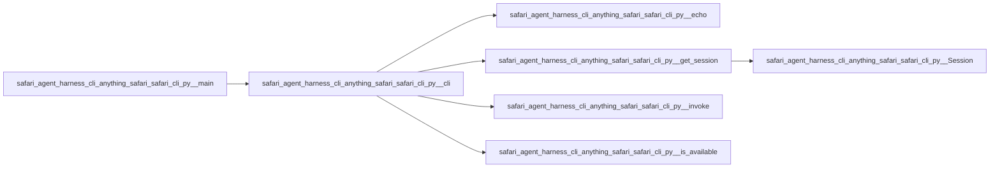

# req-overview

## 需求原文

## 背景

CLI-Anything 是个大仓库（1700 多个文件），第一眼看不到全貌：顶层有
几十个软件目录（`blender`、`gimp`、`obsidian`……），又有 `cli-hub`、
`cli-anything-plugin`、`skills`、`skill_generation`、`cli-hub-matrix`、
`docs` 这些横向部件。本需求要一张仓库全图：各部分是什么、彼此怎么
连起来。

## 需求

- 说清顶层目录分工：`cli-anything-plugin`（Claude Code 插件，含
  `HARNESS.md` 方法论、`repl_skin.py`、`commands/`）、`cursor-plugin` /
  `codex-skill` / `hermes-skill` / `reasonix-skill`（各家智能体入口）、
  `cli-hub`（包管理器）、`skills/`（71 个 `cli-anything-<软件>` 的
  canonical SKILL.md）、各软件目录下的 `agent-harness/`（真正的 CLI
  外壳）、`cli-hub-matrix/`（分领域配方）、`docs/`（预览机制等文档）。
- 说清三份注册表 `registry.json` / `public_registry.json` /
  `matrix_registry.json` 各自管什么。
- 说清一条线怎么走通：从“想给某个软件做 CLI”到“智能体在终端里调用
  它”，经过哪几个部件。

## 验收标准

- [ ] 知识页有一张模块分工表，覆盖插件、包管理器、技能库、软件外壳四层
- [ ] 知识页说清三份注册表的分工
- [ ] 知识页有一条端到端的链路说明
- [ ] 最小上下文 ≤10 个文件，≤8000 tokens

来源：/home/hatch/workspace/req-code-kb-work/cli-anything-kb/req-overview.md

## 相关文件 / 函数

| 文件 | 关联 | 命中符号 |
| --- | --- | --- |
| [README.md](https://github.com/HKUDS/CLI-Anything/blob/34f519533bc175d2fe287ab8316b0dd99bb9cc43/README.md) | 种子 | — |
| [cli-anything-plugin/README.md](https://github.com/HKUDS/CLI-Anything/blob/34f519533bc175d2fe287ab8316b0dd99bb9cc43/cli-anything-plugin/README.md) | 种子 | — |
| [cli-hub/cli_hub/matrix.py](https://github.com/HKUDS/CLI-Anything/blob/34f519533bc175d2fe287ab8316b0dd99bb9cc43/cli-hub/cli_hub/matrix.py) | 1 跳邻居 | `fetch_matrix_registry` (L65) |
| [cli-hub/cli_hub/matrix_skill.py](https://github.com/HKUDS/CLI-Anything/blob/34f519533bc175d2fe287ab8316b0dd99bb9cc43/cli-hub/cli_hub/matrix_skill.py) | 2 跳邻居 | `_render_stage_tooling` (L355), `render_matrix_skill_file` (L116), `_render_discovery_section` (L395) |
| [safari/agent-harness/cli_anything/safari/safari_cli.py](https://github.com/HKUDS/CLI-Anything/blob/34f519533bc175d2fe287ab8316b0dd99bb9cc43/safari/agent-harness/cli_anything/safari/safari_cli.py) | 种子 | `cli` (L189), `get_session` (L81), `main` (L621) |
| [cli-hub/cli_hub/installer.py](https://github.com/HKUDS/CLI-Anything/blob/34f519533bc175d2fe287ab8316b0dd99bb9cc43/cli-hub/cli_hub/installer.py) | 2 跳邻居 | `update_cli` (L372), `_load_installed` (L19), `_install_strategy` (L106) |
| [docs/scripts/freecad_live_preview_demo.py](https://github.com/HKUDS/CLI-Anything/blob/34f519533bc175d2fe287ab8316b0dd99bb9cc43/docs/scripts/freecad_live_preview_demo.py) | 2 跳邻居 | `_hex_rgb` (L4082), `_rgba` (L4087), `parse_args` (L4897) |
| [cli-hub/tests/test_matrix_skill_dist.py](https://github.com/HKUDS/CLI-Anything/blob/34f519533bc175d2fe287ab8316b0dd99bb9cc43/cli-hub/tests/test_matrix_skill_dist.py) | 2 跳邻居 | `_demo_matrix` (L39), `_make_content_dir` (L19), `TestLookupChain.test_published_url_used_when_no_local_content.FakeResponse` (L133) |
| [mubu/agent-harness/skill_generator.py](https://github.com/HKUDS/CLI-Anything/blob/34f519533bc175d2fe287ab8316b0dd99bb9cc43/mubu/agent-harness/skill_generator.py) | 2 跳邻居 | `extract_cli_metadata` (L213), `extract_system_package` (L75), `extract_intro_from_readme` (L53) |
| [safari/agent-harness/cli_anything/safari/tests/test_parity.py](https://github.com/HKUDS/CLI-Anything/blob/34f519533bc175d2fe287ab8316b0dd99bb9cc43/safari/agent-harness/cli_anything/safari/tests/test_parity.py) | 2 跳邻居 | `_cli_name_for` (L27), `TestParityToolCoverage.setup_method` (L38), `TestParityToolCoverage` (L35) |

共 10 个文件，约 6642 tokens（预算内）。

## 调用链

## 群消息佐证

暂无。

## 验收

- [ ] 核心改动文件在上方清单中
- [ ] 召回覆盖真实改动文件（盲测见 `tests/test_blind.py`）

