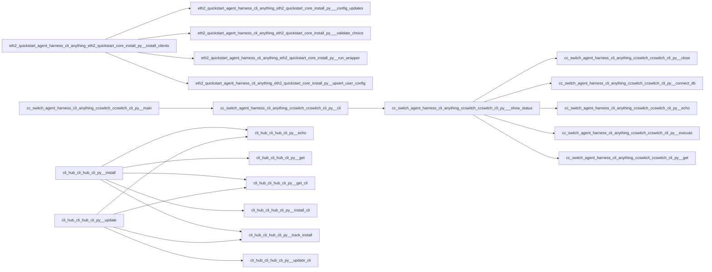

# req-selling

## 需求原文

## 背景

CLI-Anything 对外讲的故事：现在的软件是给人用的，未来的用户是智能体；
它要把智能体与全世界软件之间的鸿沟桥起来。本需求要它的卖点清单——
每个卖点都要有仓库里的证据（数字、功能、实例），不是空口号。

## 需求

- 说清它宣称解决的五个痛点与对应的解法（`Key Features` 一节的对照表：
  AI 用不了真工具 / UI 自动化总崩 / 智能体要结构化数据 / 定制集成贵 /
  原型与生产之间有鸿沟），每个解法配仓库里的证据。
- 说清数量证据：40+ 个 CLI 外壳、18 个主要应用、2461 个通过的测试
  （README 徽章）、`Test Results` 一节的测试分层（单元 + 真实软件
  E2E + CLI 子进程验证），以及各软件外壳的测试数（如 blender 208、
  inkscape 202、audacity 161）。
- 说清三种用法（`What Can You Do` 一节）：让智能体接手工作流、把零散
  API 统一成一个 CLI、替代或增强 GUI 智能体。
- 说清分发与发现：`CLI-Hub`（`cli-hub install <name>`）、`npx skills`
  一键装技能、Web Hub。
- 说清真实演示：`Real-World Demos` / `Demonstrations` 里的实例（CAD、
  3D 场景、图表、字幕等）。

## 验收标准

- [ ] 知识页有五个痛点对照表，每个解法都有仓库证据
- [ ] 知识页有数量证据（CLI 数、应用数、测试数与分层）
- [ ] 知识页有三种用法与分发发现方式
- [ ] 最小上下文 ≤10 个文件，≤8000 tokens

来源：/home/hatch/workspace/req-code-kb-work/cli-anything-kb/req-selling.md

## 相关文件 / 函数

| 文件 | 关联 | 命中符号 |
| --- | --- | --- |
| [README.md](https://github.com/HKUDS/CLI-Anything/blob/34f519533bc175d2fe287ab8316b0dd99bb9cc43/README.md) | 种子 | — |
| [eth2-quickstart/agent-harness/cli_anything/eth2_quickstart/core/install.py](https://github.com/HKUDS/CLI-Anything/blob/34f519533bc175d2fe287ab8316b0dd99bb9cc43/eth2-quickstart/agent-harness/cli_anything/eth2_quickstart/core/install.py) | 种子 | `_config_updates` (L24), `_validate_choice` (L19), `install_clients` (L43) |
| [cli-anything-plugin/HARNESS.md](https://github.com/HKUDS/CLI-Anything/blob/34f519533bc175d2fe287ab8316b0dd99bb9cc43/cli-anything-plugin/HARNESS.md#L10) | 种子 | § Agent Harness: GUI-to-CLI for Open Source Software / General SOP: Turning Any GUI App into an Agent-Usable CLI (L10-L304) |
| [cli-hub-meta-skill/SKILL.md](https://github.com/HKUDS/CLI-Anything/blob/34f519533bc175d2fe287ab8316b0dd99bb9cc43/cli-hub-meta-skill/SKILL.md#L87) | 种子 | § CLI-Hub Meta-Skill / How to Use (L87-L94) |
| [skills/cli-hub-meta-skill/SKILL.md](https://github.com/HKUDS/CLI-Anything/blob/34f519533bc175d2fe287ab8316b0dd99bb9cc43/skills/cli-hub-meta-skill/SKILL.md#L12) | 种子 | § CLI-Hub Meta-Skill / Quick Start (L12-L31) |
| [cli-hub/cli_hub/matrix_skill.py](https://github.com/HKUDS/CLI-Anything/blob/34f519533bc175d2fe287ab8316b0dd99bb9cc43/cli-hub/cli_hub/matrix_skill.py) | 2 跳邻居 | `_render_stage_tooling` (L355), `render_matrix_skill_file` (L116), `_render_discovery_section` (L395) |
| [cc-switch/agent-harness/cli_anything/ccswitch/ccswitch_cli.py](https://github.com/HKUDS/CLI-Anything/blob/34f519533bc175d2fe287ab8316b0dd99bb9cc43/cc-switch/agent-harness/cli_anything/ccswitch/ccswitch_cli.py) | 种子 | `cli` (L181), `skills` (L698), `_show_status` (L198), `main` (L982) |
| [cli-hub/cli_hub/cli.py](https://github.com/HKUDS/CLI-Anything/blob/34f519533bc175d2fe287ab8316b0dd99bb9cc43/cli-hub/cli_hub/cli.py) | 种子 | `install` (L130), `update` (L163) |
| [cli-hub/cli_hub/installer.py](https://github.com/HKUDS/CLI-Anything/blob/34f519533bc175d2fe287ab8316b0dd99bb9cc43/cli-hub/cli_hub/installer.py) | 种子 | `install_cli` (L339) |
| [cli-hub/cli_hub/matrix.py](https://github.com/HKUDS/CLI-Anything/blob/34f519533bc175d2fe287ab8316b0dd99bb9cc43/cli-hub/cli_hub/matrix.py) | 2 跳邻居 | `provider_cli_name` (L293), `_package_available` (L150) |

共 10 个文件，约 7933 tokens（预算内），分级：full——完整（跨多文件、核心逻辑）。

## 调用链

## 影响面

改种子文件之前先看这一节：列出调用种子符号的上游文件，也就是改动最先波及的地方（取每文件前 3 个调用者，按调用者重要性排序）。

- 改 `cc-switch/agent-harness/cli_anything/ccswitch/ccswitch_cli.py` 会波及：`cc-switch/agent-harness/cli_anything/ccswitch/ccswitch_cli.py` 的 `main`

## 群消息佐证

暂无。

## 验收

- [ ] 核心改动文件在上方清单中
- [ ] 召回覆盖真实改动文件（盲测见 `tests/test_blind.py`）

