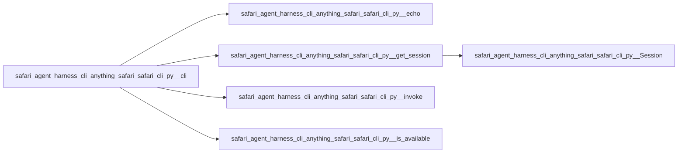

# req-selling

## 需求原文

## 背景

CLI-Anything 对外讲的故事：现在的软件是给人用的，未来的用户是智能体；
它要把智能体与全世界软件之间的鸿沟桥起来。本需求要它的卖点清单——
每个卖点都要有仓库里的证据（数字、功能、实例），不是空口号。

## 需求

- 说清它宣称解决的五个痛点与对应的解法（`Key Features` 一节的对照表：
  AI 用不了真工具 / UI 自动化总崩 / 智能体要结构化数据 / 定制集成贵 /
  原型与生产之间有鸿沟），每个解法配仓库里的证据。
- 说清数量证据：40+ 个 CLI 外壳、18 个主要应用、2461 个通过的测试
  （README 徽章）、`Test Results` 一节的测试分层（单元 + 真实软件
  E2E + CLI 子进程验证），以及各软件外壳的测试数（如 blender 208、
  inkscape 202、audacity 161）。
- 说清三种用法（`What Can You Do` 一节）：让智能体接手工作流、把零散
  API 统一成一个 CLI、替代或增强 GUI 智能体。
- 说清分发与发现：`CLI-Hub`（`cli-hub install <name>`）、`npx skills`
  一键装技能、Web Hub。
- 说清真实演示：`Real-World Demos` / `Demonstrations` 里的实例（CAD、
  3D 场景、图表、字幕等）。

## 验收标准

- [ ] 知识页有五个痛点对照表，每个解法都有仓库证据
- [ ] 知识页有数量证据（CLI 数、应用数、测试数与分层）
- [ ] 知识页有三种用法与分发发现方式
- [ ] 最小上下文 ≤10 个文件，≤8000 tokens

来源：/home/hatch/workspace/req-code-kb-work/cli-anything-kb/req-selling.md

## 相关文件 / 函数

| 文件 | 关联 | 命中符号 |
| --- | --- | --- |
| [README.md](https://github.com/HKUDS/CLI-Anything/blob/34f519533bc175d2fe287ab8316b0dd99bb9cc43/README.md) | 种子 | — |
| [cli-anything-plugin/HARNESS.md](https://github.com/HKUDS/CLI-Anything/blob/34f519533bc175d2fe287ab8316b0dd99bb9cc43/cli-anything-plugin/HARNESS.md) | 种子 | — |
| [skills/cli-hub-meta-skill/SKILL.md](https://github.com/HKUDS/CLI-Anything/blob/34f519533bc175d2fe287ab8316b0dd99bb9cc43/skills/cli-hub-meta-skill/SKILL.md) | 种子 | — |
| [cli-hub-meta-skill/SKILL.md](https://github.com/HKUDS/CLI-Anything/blob/34f519533bc175d2fe287ab8316b0dd99bb9cc43/cli-hub-meta-skill/SKILL.md) | 种子 | — |
| [cli-hub/cli_hub/matrix_skill.py](https://github.com/HKUDS/CLI-Anything/blob/34f519533bc175d2fe287ab8316b0dd99bb9cc43/cli-hub/cli_hub/matrix_skill.py) | 2 跳邻居 | `_render_stage_tooling` (L355), `render_matrix_skill_file` (L116), `_render_discovery_section` (L395) |
| [cli-hub/cli_hub/matrix.py](https://github.com/HKUDS/CLI-Anything/blob/34f519533bc175d2fe287ab8316b0dd99bb9cc43/cli-hub/cli_hub/matrix.py) | 2 跳邻居 | `resolve_install_scope` (L352), `provider_cli_name` (L293), `_package_available` (L150) |
| [safari/agent-harness/cli_anything/safari/tests/test_full_e2e.py](https://github.com/HKUDS/CLI-Anything/blob/34f519533bc175d2fe287ab8316b0dd99bb9cc43/safari/agent-harness/cli_anything/safari/tests/test_full_e2e.py) | 2 跳邻居 | `TestCLISubprocess._run` (L190), `_resolve_cli` (L64), `_should_skip_e2e` (L36) |
| [safari/agent-harness/cli_anything/safari/safari_cli.py](https://github.com/HKUDS/CLI-Anything/blob/34f519533bc175d2fe287ab8316b0dd99bb9cc43/safari/agent-harness/cli_anything/safari/safari_cli.py) | 种子 | `cli` (L189), `get_session` (L81) |

共 8 个文件，约 7998 tokens（预算内）。

## 调用链

## 群消息佐证

暂无。

## 验收

- [ ] 核心改动文件在上方清单中
- [ ] 召回覆盖真实改动文件（盲测见 `tests/test_blind.py`）

